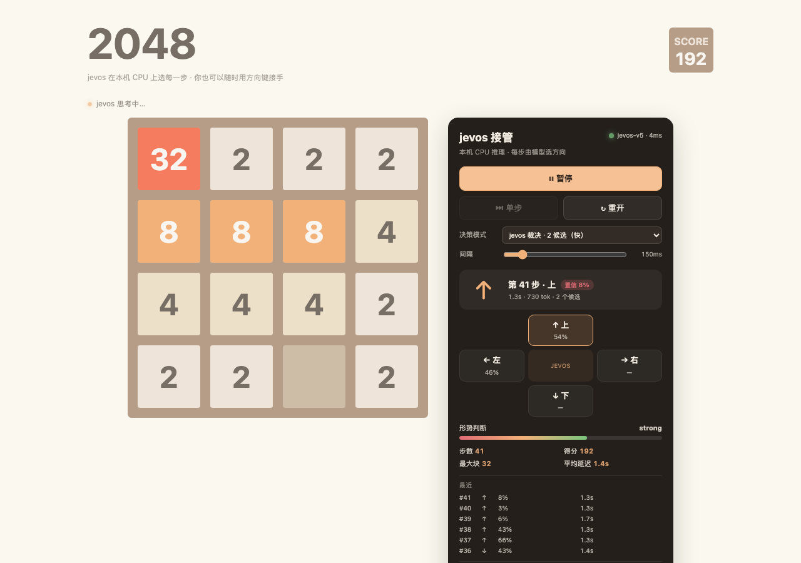

# 2048 × jevos

浏览器里是一局**完整可手玩的 2048**（fork 自 [mateuszsokola/2048-in-react](https://github.com/mateuszsokola/2048-in-react)，MIT），右侧面板让**本机模型**来选每一步：方向、每个候选的概率、置信度、推理延迟、token 数，以及它这一步看到的完整提示词，全部实时摊开。

多个引擎，同一套协议，可在配置或页面上切换：

- **jevos**（默认）：C++ / OpenVINO int8，纯 CPU；
- **ollama**：`clef-flash:9b`（decision 模型，Q8_0），有 GPU 时自动跑 GPU；
- **ollama-27b**：`clef:27b`（27B Q4_K_M，约 18 GB），同一个 ollama 守护进程，
  需要把层摊到多张卡上（`deploy/ollama-gpu.sh`）。



## 快速开始（部署）

环境：Node >= 18.17。jevos 二进制与 679 MB 模型由脚本自动下载（Linux x86_64 / macOS arm64）。

```bash
git clone <this-repo> 2048-jevos && cd 2048-jevos
bash deploy/install.sh          # 下载 + 校验 + 解模型 + npm ci + build + 启动
# 打开 http://<host>:3000/
```

指定数据目录（游戏与 jevos 同目录）、离线资产、端口等：

```bash
bash deploy/install.sh --data-dir /data/home/laurence/game2048/jevos
bash deploy/install.sh --assets-dir /path/to/pre-downloaded
bash deploy/install.sh --port 3000 --threads 4
```

用 ollama 而不是 jevos（跳过 jevos 资产下载）：

```bash
bash deploy/install.sh --provider ollama          # 默认引擎 = ollama（clef-flash:9b）
bash deploy/install.sh --provider ollama27b       # 默认引擎 = ollama-27b（clef:27b）
bash deploy/switch-provider.sh ollama             # 已装好的环境里切换并重启
```

运维：`bash deploy/start.sh` · `bash deploy/status.sh` · `bash deploy/stop.sh`。
完整安装说明、agent 清单、离线安装与已知坑见 **[docs/DEPLOY.md](docs/DEPLOY.md)**。

### 开发模式

```bash
npm install
npm run dev:all                 # 起 jevos（.jevos/jev 或 JEVOS_DIR）+ next dev
```

`JEVOS_DIR` 指向 jevos 目录（默认 `<repo>/.jevos/jev`）；`JEVOS_URL` 只改 API 指向。

## 推理引擎：jevos、ollama 与 StartLux（可在配置中切换）

| 引擎            | 传输                | 默认地址                 | 默认模型                                       | 适用                                   |
| --------------- | ------------------- | ------------------------ | ---------------------------------------------- | -------------------------------------- |
| `jevos`（默认） | CPU · OpenVINO int8 | `http://127.0.0.1:8017`  | `jev-latest`（实际 `jevos-v5`）                | 单机无 GPU，零依赖                     |
| `ollama`        | GPU（有卡时）       | `http://127.0.0.1:11434` | `clef-flash:9b`                                | 已有 ollama / GPU 空闲的机器           |
| `ollama27b`     | GPU · 多卡分摊      | `http://127.0.0.1:11434` | `clef:27b`（27B Q4_K_M）                       | 想在同一个 ollama 里再放一个更大的脑子 |
| `startlux`      | GPU · llama.cpp     | `http://127.0.0.1:8081`  | `StartLux-Decision-v1.1-9B-Instant`（Q8_0）    | 有 GGUF + 想换一个决策模型             |
| `startlux27b`   | GPU · llama.cpp     | `http://127.0.0.1:8082`  | `StartLux-Decision-v1.1-27B-Instant`（Q4_K_M） | 同机想同时留一个更大的脑子             |

ollama ≥ 0.40 为 decision 模型（如 `clef-flash:9b`）提供 **`/v1/systemone`**，StartLux-Decision 的
`startlux-decide serve` 也提供同一协议；请求与响应和 jevos 逐字段一致：

```
POST {endpoint}/v1/systemone   { model, state, questions }  →  { answers, usage }
```

所以切引擎**不改 prompt、不改 API 形状**——只换 endpoint 与模型名。完整的引擎抽象在 `lib/engine.ts`。

> `clef-flash:9b` 只支持 decision 协议：`/api/chat` 与 `/api/generate` 会返回
> `does not support chat` / `does not support generate`，这是正常的，必须走 `/v1/systemone`。

### 三种切换方式（优先级从高到低）

1. **页面右侧「引擎」下拉** —— 只影响当前浏览器（`localStorage`），适合当场对比几个模型；
2. **服务端配置 `AI_PROVIDER`** —— 决定"没有本地选择时"的默认引擎；
3. **请求体 `provider` 字段** —— 直接调 API 时逐次指定。

### 在配置里切换

开发机，写 `.env.local`（Next 会自动加载）：

```bash
AI_PROVIDER=ollama
OLLAMA_URL=http://127.0.0.1:11434
OLLAMA_MODEL=clef-flash:9b
OLLAMA_KEEP_ALIVE=30m
# 27B 另加一条（同一个守护进程，不替换 9B）：
OLLAMA27_URL=http://127.0.0.1:11434
OLLAMA27_MODEL=clef:27b
```

部署环境，改 `<data-dir>/deploy.env` 后重启，或用一条命令：

```bash
bash deploy/switch-provider.sh ollama                     # 切到 ollama 9B 并重启
bash deploy/switch-provider.sh ollama clef-flash:9b       # 同时指定模型
bash deploy/switch-provider.sh ollama27b                  # 切到 ollama 27B（clef:27b）
bash deploy/switch-provider.sh ollama27b clef:27b-q4      # 同时指定 27B 模型
bash deploy/switch-provider.sh jevos                      # 切回 jevos（会重新起 jevos）
```

ollama 侧准备：

```bash
ollama serve                                            # 或 docker run -d --gpus=all -p 11434:11434 ollama/ollama
ollama pull clef-flash:9b                               # 10.6 GB（Q8_0，9.1B）
ollama pull clef:27b                                    # 约 18 GB（Q4_K_M，27B）——与 9B 并存，不替换
```

**冷启动**：首次请求要加载 10.6 GB 模型，实测 ~110 s（4× NVIDIA A2）。之后：浅局单问 **0.32–0.67 s**；
真实对局 120 步实测 **assisted 均值 1.39 s/步、hinted 均值 1.00 s/步**（含 HTTP 与 Next 转发）。
再用 `OLLAMA_KEEP_ALIVE`（默认 `30m`）让模型常驻，避免每隔半小时重新加载。

#### ollama 27B（`clef:27b`）与 GPU 分摊

`ollama27b` 是**新增**的第五个引擎，不是把 `ollama` 换掉：两者指向同一个 ollama 守护进程
（默认 `:11434`），只是模型名不同（`clef-flash:9b` / `clef:27b`），页面下拉里可以随时切换。

```bash
AI_PROVIDER=ollama27b，对应
OLLAMA27_URL=http://127.0.0.1:11434
OLLAMA27_MODEL=clef:27b

bash deploy/switch-provider.sh ollama27b      # 改服务端默认引擎并重启 Web
```

**为什么要单独配 GPU**：`clef:27b` 是 27B Q4_K_M，权重约 18 GB，而本机 4×A2 **单卡只有 15.3 GB**。
ollama 默认会把能塞进一张卡的模型都放一张卡（实测 9B 的 llama-server 是
`--split-mode none --main-gpu 0`，已经占掉 GPU 0 的 13 GB），27B 放不下时必须跨卡，
余量很紧。用仓库里的脚本把容器重建成「四卡分摊 + 两个模型常驻」：

```bash
bash deploy/ollama-gpu.sh status    # 看容器 env、显存、已拉取的模型
bash deploy/ollama-gpu.sh apply     # 重建容器：OLLAMA_SCHED_SPREAD=1 等（保留数据卷）
```

脚本写入的关键 env：

| 变量                       | 值     | 作用                                   |
| -------------------------- | ------ | -------------------------------------- |
| `OLLAMA_SCHED_SPREAD`      | `1`    | 把层摊到所有可见 GPU（27B 单卡放不下） |
| `OLLAMA_MAX_LOADED_MODELS` | `2`    | 允许 9B 与 27B 同时常驻                |
| `OLLAMA_NUM_PARALLEL`      | `1`    | 每个模型一个并发，省 KV 显存           |
| `OLLAMA_KV_CACHE_TYPE`     | `q8_0` | KV cache 量化                          |
| `OLLAMA_FLASH_ATTENTION`   | `1`    | 开 flash attention                     |
| `OLLAMA_KEEP_ALIVE`        | `30m`  | 常驻时长                               |

> `apply` **会重建容器**（同名、同镜像、同 `/root/.ollama` 数据卷、同端口）。如果正在
> `ollama pull clef:27b`，脚本会拒绝执行（`--force` 才会强来），避免下载作废。

冷启动：18 GB 权重读进显存通常要 2–4 分钟，期间第一次 `/v1/systemone` 会一直等到加载完
（app 侧超时放宽到 300 s）。之后与 9B 同量级，主要差别在每步推理更慢。

### StartLux-Decision（GGUF + llama.cpp）

StartLux 是一个**生成式决策模型**（Qwen3.5-9B 后训练，Q8_0 9.53 GB），它的概率读出口令、选项字母
映射和温度都写在模型文件夹里，**不是** llama.cpp 自带的 chat 能力。因此要把两段接起来：

```bash
# 1) llama-server 只负责跑 GGUF（Instant 模型是双向注意力，这几个参数不能省）
llama-server -m <folder>/StartLux-Decision-v1.1-9B-Instant-Q8_0.gguf \
  -ngl 99 -c 20480 --parallel 1 --ctx-checkpoints 0 -b 16384 -ub 16384 --port 8018

# 2) 决策服务在 8081，对外提供 /v1/systemone
pip install startlux-decide
STARTLUX_LLAMACPP_BIDIR=server startlux-decide serve \
  --model <folder> --backend llamacpp --llamacpp-url http://127.0.0.1:8018 \
  --port 8081 --name StartLux-Decision-v1.1-9B-Instant
```

**9B 与 27B 同时常驻**（推荐）：两条 GGUF 各起一个 llama-server，各挂一个决策服务，
页面「引擎」下拉里同时出现 `startlux` 与 `startlux-27b`：

```
9B  Q8_0   llama-server 8018 -> decision API 8081   (provider startlux)
27B Q4_K_M llama-server 8019 -> decision API 8082   (provider startlux27b)
```

```bash
bash deploy/startlux-both.sh start     # 起两个模型 + 两个决策服务（幂等）
bash deploy/startlux-both.sh status    # 四个端口的 http/pid
bash deploy/startlux-both.sh stop      # 全部停掉
```

对应配置（`deploy.env` / `.env.local`）：

```bash
AI_PROVIDER=startlux                  # 默认用 9B；startlux27b 可在页面或用 switch-provider 切
STARTLUX_URL=http://127.0.0.1:8081
STARTLUX_MODEL=StartLux-Decision-v1.1-9B-Instant
STARTLUX27_URL=http://127.0.0.1:8082
STARTLUX27_MODEL=StartLux-Decision-v1.1-27B-Instant

bash deploy/switch-provider.sh startlux27b   # 把默认引擎切成 27B
```

**显存**：9B Q8_0 = 9.5 GB，27B Q4_K_M = 16.5 GB，合计 26 GB 权重，4×A2 共 61 GB。
关键是**别把 `-b/-ub` 开大**：`-ub 16384` 会为 logits 预留 `batch × vocab × 4 B` 的缓冲
（几 GB/卡），单模型就能吃掉 ~48 GB。`deploy/startlux-llama.sh` 现在默认
`-c 4096 -b 2048 -ub 512`（决策 prompt 只有 ~700 token），两个模型可同时常驻。

4×A2 实测：9B 一次 hinted 决策（4 候选）约 0.8–1.2 s；27B 约 3.8 s。冷启动 27B 需要把
16.5 GB 读进显存（约 1–2 min），期间 llama-server `/health` 返回 `503 Loading model`。

- **模型文件夹不止 GGUF**：还需要 `config.json`、`decision_config.json`、`tokenizer.json`、
  `tokenizer_config.json`、`vocab.json`、`merges.txt`、`chat_template.jinja`、`preprocessor_config.json`
  —— 从 BF16 仓库下载时用 `--exclude "*.safetensors"` 取这些文件。
- **不能拿 llama-server 的 `/v1/chat/completions` 顶替**：普通 chat 不会产出 StartLux 的选项字母概率。
- 切换：`AI_PROVIDER=startlux|startlux27b` + 对应的 `STARTLUX_*` / `STARTLUX27_*`，或
  `bash deploy/switch-provider.sh startlux` / `... startlux27b`。
- 健康：`curl -s http://127.0.0.1:8081/health`（9B）· `http://127.0.0.1:8082/health`（27B）
  → `{"status":"ok","model":"...","kind":"instant"}`。

## 界面

| 控件                        | 作用                                                                                  |
| --------------------------- | ------------------------------------------------------------------------------------- |
| **▶ 让 AI 开始 / ⏸ 暂停** | 开始或暂停自动走；暂停后方向键可手动玩                                                |
| **⏭ 单步**                 | 只让当前引擎走一步，然后自动暂停                                                      |
| **引擎**                    | jevos / ollama（9B）/ ollama-27b / startlux（9B）/ startlux-27b，切换只影响当前浏览器 |
| **↻ 重开**                  | 重置棋盘；如果正在自动走，会接着新局继续                                              |
| **决策模式**                | 见下表                                                                                |
| **间隔**                    | 两步之间的额外等待（0–1200 ms），不含模型推理时间                                     |

棋盘上方的小圆点：绿色=空闲，橙色脉冲=jevos 正在推理，灰色=暂停。

## 三种决策模式

| 模式                            | 给 jevos 的候选              | 约延迟                                         | 说明                                                                            |
| ------------------------------- | ---------------------------- | ---------------------------------------------- | ------------------------------------------------------------------------------- |
| **裁决 · 2 候选（快）**（默认） | 启发式排名前 2 的合法走法    | jevos ~1.3 s · ollama ~0.4 s · startlux ~1.0 s | 先用 1-ply 启发式把明显差的走法筛掉，再由模型二选一。测试局 145 步 / 最高块 128 |
| **自选 · 4 候选（慢）**         | 全部合法走法，附带启发式评分 | jevos ~2.5 s · ollama ~0.7 s · startlux ~1.2 s | 模型看到完整局面 + 每个方向的 `eval`，自主性更高                                |
| **纯模型 · 无提示**             | 全部合法走法，不带评分       | jevos ~2.5 s · ollama ~0.7 s · startlux ~1.2 s | 最"裸"的模型；测试局 108 步 / 最高块 64                                         |

> **为什么默认不是"纯模型"？** jevos / clef 都是通用决策模型（yes/no、choice、score），不是 2048 求解器。它们的空间规划能力有限，纯 4 选 1 通常在 64 块左右结束。默认模式用一个很小的 1-ply 启发式做**候选过滤**，最终选择仍由模型做出；面板会把"哪些走法进了候选、概率各是多少"全部显示出来，不藏规则。想比较模型自己有多强，切到"纯模型"即可。

启发式只做候选排序（空格数、单调性、最大块是否在角、可合并对数），不直接落子；真正的落子来自 `/api/jevos/move` 返回的 `choice`。

## 它是怎么跑起来的

```
浏览器（React 2048）
  │  POST /api/jevos/move { board, score, moves, mode, provider, exclude }
  ▼
Next.js API 路由（同源，无 CORS）
  │  按 provider 选引擎（lib/engine.ts）
  ├──> jevos  http://127.0.0.1:8017/v1/systemone   （CPU · OpenVINO int8）
  ├──> ollama   http://127.0.0.1:11434/v1/systemone （GPU · clef-flash:9b）
  ├──> ollama27b http://127.0.0.1:11434/v1/systemone （GPU · clef:27b，多卡分摊）
  └──> startlux      http://127.0.0.1:8081/v1/systemone （GPU · llama.cpp + 9B GGUF）
  └──> startlux27b   http://127.0.0.1:8082/v1/systemone （GPU · llama.cpp + 27B GGUF）
  │  choice + 每个候选概率 + score 形势判断
  ▼
浏览器用游戏自己的 reducer 落子，等动画结束，再走下一步
```

关键文件：

| 文件                        | 职责                                                                                                                                           |
| --------------------------- | ---------------------------------------------------------------------------------------------------------------------------------------------- |
| `lib/game.ts`               | 4×4 引擎：`[x,y]`→`board[y][x]`、四个方向模拟、合法走法、1-ply 启发式、提示词里的局面描述                                                      |
| `lib/prompt.ts`             | 三种模式的 prompt：state + 每个候选一行说明 + choice/score 问题                                                                                |
| `lib/engine.ts`             | 引擎注册与解析（jevos / ollama / ollama27b / startlux / startlux27b）、健康检查、`/v1/systemone` 客户端；ollama 冷启动 180 s，27B 放宽到 300 s |
| `pages/api/jevos/move.ts`   | 校验棋盘、枚举合法走法、调模型、把 choice 概率和 outlook 原样返回；只有一个合法走法时不调用模型                                                |
| `pages/api/jevos/health.ts` | 面板左上角那个绿点就是它                                                                                                                       |
| `context/ai-context.tsx`    | 自动循环、暂停/单步/重开、动画等待、no-op 防护（同一局面某方向不生效就排除它重试）                                                             |
| `components/ai-panel.tsx`   | 面板 UI                                                                                                                                        |
| `components/board.tsx`      | 原游戏棋盘；AI 运行时屏蔽方向键                                                                                                                |

一次请求的 prompt 长这样（面板里可展开看全文）：

```
state: 2048 4x4. score 60, move 15. board: 16 4 2 0 / 4 2 0 0 / ...
questions.move: {
  type: "choice",
  instructions: "Pick the better of these two candidate 2048 moves...",
  criteria: {
    left:  "left: => 16 4 2 0 / ...; +8, 9 empty, max 16 corner, mono 0.92, eval 6012",
    up:    "up:   => ..."
  }
}
questions.outlook: { type: "score", criteria: ["losing","weak","ok","strong","winning"] }
```

## 直接调 API

```bash
# 用服务端配置的默认引擎
curl -s -X POST http://localhost:3000/api/jevos/move \
  -H 'Content-Type: application/json' \
  -d '{"board":[[2,2,0,0],[4,0,0,0],[0,0,0,0],[0,0,0,0]],"score":12,"moves":3,"mode":"assisted"}'

# 显式指定引擎（逐次覆盖配置）
curl -s -X POST http://localhost:3000/api/jevos/move \
  -H 'Content-Type: application/json' \
  -d '{"provider":"ollama","board":[[2,2,0,0],[4,0,0,0],[0,0,0,0],[0,0,0,0]],"score":12,"moves":3,"mode":"assisted"}'
```

返回（`engine` 字段回显本次实际使用的引擎）：

```json
{
  "model": "jevos-v5",
  "engine": {
    "id": "jevos",
    "label": "jevos",
    "model": "jevos-v5",
    "transport": "cpu"
  },
  "move": {
    "choice": "left",
    "probabilities": { "left": 0.51, "up": 0.49 },
    "confidence": 0.02
  },
  "outlook": {
    "score": 1.8,
    "label": "ok",
    "probabilities": {},
    "confidence": 0.29
  },
  "legal": ["left", "up", "down"],
  "candidates": ["left", "up"],
  "prompt": { "state": "...", "instructions": "...", "criteria": {} },
  "latencyMs": 1300,
  "usage": { "input_tokens": 730, "output_tokens": 0 },
  "skipped": false,
  "fallback": false
}
```

- `confidence` 是 jevos 对 choice 的置信度；**经常会很低**（0.0x），面板会用红色标出来。这不是 bug，是这个小模型的真实状态。
- 只有一个合法走法时 `skipped: true`，不浪费一次模型调用。
- 模型选了候选之外的方向时 `fallback: true`，会退到概率最高的合法候选。

## 验证

```bash
npx jest --runInBand --watchAll=false   # 52 passed（含 9 条引擎解析用例）
npm run build                           # Next 生产构建通过
npm run lint                            # No ESLint warnings or errors
```

## 环境变量

| 变量                      | 默认                     | 说明                                                                    |
| ------------------------- | ------------------------ | ----------------------------------------------------------------------- |
| `AI_PROVIDER`             | `jevos`                  | 默认引擎：`jevos` / `ollama` / `ollama27b` / `startlux` / `startlux27b` |
| `JEVOS_URL`               | `http://127.0.0.1:8017`  | jevos 地址                                                              |
| `JEVOS_MODEL`             | `jev-latest`             | 请求里的 model 名                                                       |
| `OLLAMA_URL`              | `http://127.0.0.1:11434` | ollama 地址                                                             |
| `OLLAMA_MODEL`            | `clef-flash:9b`          | ollama 9B 决策模型（必须是 decision 模型）                              |
| `OLLAMA_KEEP_ALIVE`       | `30m`                    | 模型常驻时长（冷加载一次 ~110 s）                                       |
| `OLLAMA27_URL`            | `http://127.0.0.1:11434` | ollama-27b 的守护进程地址（可与 9B 相同）                               |
| `OLLAMA27_MODEL`          | `clef:27b`               | ollama 27B 决策模型                                                     |
| `OLLAMA27_KEEP_ALIVE`     | 继承 `OLLAMA_KEEP_ALIVE` | 27B 的常驻时长（可选覆盖）                                              |
| `JEVOS_DIR`               | `<repo>/.jevos/jev`      | `dev:all` 启动 jevos 时用的目录                                         |
| `JEVOS_THREADS`           | `4`                      | `dev:all` 传给 `jev serve --threads`                                    |
| `JEVOS_DATA_DIR`          | `<repo>/.jevos`          | 部署脚本的数据目录（二进制、模型、日志）                                |
| `WEB_PORT` / `JEVOS_PORT` | `3000` / `8017`          | 部署脚本使用的端口                                                      |
| `JEVOS_ASSET_BASE`        | GitHub Releases          | 资产下载基址（镜像/代理）                                               |
| `PORT`                    | `3000`                   | Next.js 端口                                                            |

## 已知限制

- **模型不是 2048 AI**：jevos / clef 都没有搜索树，只有一次前向判断；分数高低不代表模型能力，只代表这局的手气。
- **ollama 首次请求慢**：10.6 GB 模型冷加载实测 ~110 s（4× A2），之后 0.3–0.7 s/步；模型被卸载后会再加载一次。
  27B（`clef:27b`，~18 GB）冷加载 2–4 分钟，且必须让 ollama 跨卡分摊，否则会掉到 CPU。
- 默认模式里"候选过滤"是启发式，**落子**是模型；想只看模型，切"纯 jevos"。
- 每步的实际耗时 = 模型推理（0.8–2.5 s）+ 150 ms 间隔 + 约 270 ms 动画等待。
- 面板上的"置信度"是模型自报的 softmax 置信度，低置信不等于一定错，但值得注意。
- 没有做多局批量、没有做模型自对弈统计；需要的话可以在这个骨架上加。

## 归属

- 游戏 UI/引擎：[mateuszsokola/2048-in-react](https://github.com/mateuszsokola/2048-in-react)（MIT）
- 本地决策模型：[feder-cr/jev](https://github.com/feder-cr/jev)（MIT，jevos-v5 OpenVINO int8）
- 可选引擎：[ollama](https://github.com/ollama/ollama) + `clef-flash:9b`（decision 模型，走同一个 `/v1/systemone` 协议）
- 本 fork 新增：`lib/`、`context/ai-context.tsx`、`components/ai-panel.tsx`、`pages/api/jevos/*`、`scripts/dev.mjs`、`deploy/`、`docs/DEPLOY.md`、`docs/screenshot.png`
